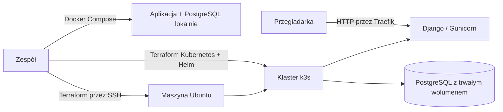

# WUDA: aplikacja ankietowa

Projekt przygotowuje przykładową aplikację Django do uruchomienia poza komputerem programisty. Docker pakuje aplikację, Kubernetes uruchamia ją i bazę danych, a Terraform przygotowuje klaster k3s oraz wdraża aplikację przez Helm.

## Jak działa wdrożenie



Najpierw Terraform łączy się przez SSH z maszyną Ubuntu, instaluje k3s i zapisuje lokalny kubeconfig. Drugi stan Terraforma używa tego kubeconfigu do utworzenia przestrzeni nazw oraz wdrożenia chartu Helm. Chart uruchamia aplikację i PostgreSQL; ingress Traefik kieruje ruch do aplikacji. Migracje bazy są wykonywane przed startem aplikacji.

## Uruchomienie lokalne

Wymagany jest Docker Desktop z uruchomionym silnikiem Linux. W PowerShell, w katalogu repozytorium:

```powershell
Copy-Item docker/.env.example docker/.env
notepad docker/.env
docker compose --env-file docker/.env -f docker/docker-compose.yml up -d --build
Invoke-WebRequest http://localhost:8000/readyz
```

W `docker/.env` ustaw własne `DJANGO_SECRET_KEY` i `DB_PASSWORD`. Aplikacja jest dostępna pod `http://localhost:8000/polls/`, a panel administracyjny pod `/admin/`. Konto administratora utworzysz poleceniem:

```powershell
docker compose --env-file docker/.env -f docker/docker-compose.yml exec web python manage.py createsuperuser
```

Zatrzymanie usług: `docker compose --env-file docker/.env -f docker/docker-compose.yml down`. Dane PostgreSQL pozostają w wolumenie; `down -v` usuwa również bazę.

## Wdrożenie na k3s

Potrzebne są: maszyna Ubuntu osiągalna przez SSH, klucz SSH z dostępem `sudo` bez hasła, Terraform, kubectl, Helm oraz Docker. Na firewallu maszyny udostępnij SSH (22) z komputera wdrożeniowego i API k3s (6443) tylko temu komputerowi. Terraform nie tworzy maszyny wirtualnej.

1. Skopiuj `infra/terraform/k3s/terraform.tfvars.example` do `terraform.tfvars`. Ustaw adres VM w `host`; w razie potrzeby zmień użytkownika i ścieżkę klucza.
2. Uruchom instalację klastra:

	```powershell
	cd infra/terraform/k3s
	terraform init
	terraform validate
	terraform plan
	terraform apply
	```

	Kubeconfig zostanie zapisany domyślnie w `~/.kube/k3s-wuda.yaml`. Zawiera dane dostępowe do klastra: nie publikuj go ani nie commituj.

3. Zbuduj i opublikuj obraz w dostępnym rejestrze. Wartości przykładowe poniżej zastąp nazwą własnego repozytorium GHCR:

	```powershell
	docker build -f docker/Dockerfile -t ghcr.io/OWNER/wuda:0.1.0 app
	docker push ghcr.io/OWNER/wuda:0.1.0
	```

	Dla prywatnego rejestru skonfiguruj `imagePullSecrets` w chartcie.

4. Skopiuj `infra/terraform/platform/terraform.tfvars.example` do `terraform.tfvars`; ustaw `image_repository`, `image_tag` oraz `ingress_host`. Następnie:

	```powershell
	cd ../platform
	terraform init
	terraform validate
	terraform plan
	terraform apply
	```

5. Skieruj DNS lub lokalny wpis hosts dla `ingress_host` na adres VM i otwórz `http://<ingress_host>/polls/`.

Usunięcie zasobów platformy: `terraform destroy` w `platform/`. Usunięcie klastra: osobno w `k3s/`; trwałe dane bazy usuń tylko świadomie. Stan Terraforma może zawierać poufne dane, więc pliki stanu pozostają lokalne i nie powinny trafiać do repozytorium.

## Konfiguracja i układ

- `app/` – aplikacja Django, endpointy `/healthz` i `/readyz` oraz zależności Pythona.
- `docker/` – obraz produkcyjny i lokalny zestaw Docker Compose z PostgreSQL.
- `infra/terraform/k3s/` – instalacja k3s przez SSH i zapis kubeconfigu.
- `infra/terraform/platform/` – namespace’y i wdrożenie chartu Helm.
- `deploy/helm/wuda/` – konfiguracja aplikacji, ingressu, sekretów oraz opcjonalnego PostgreSQL w klastrze.

Ustawienia Django i połączenie z bazą są przekazywane przez zmienne środowiskowe. W Helmie hasła są generowane przy pierwszym wdrożeniu albo pobierane ze wskazanego Kubernetes Secret. Dla zewnętrznej bazy ustaw `postgresql.enabled=false`, `database.host` i `database.existingSecret`.

## Status

Konfiguracja repozytorium, aplikacji, Dockera, Terraforma i chartu Helm jest przygotowana, ale wdrożenie na klastrze ani pełny test lokalny nie zostały jeszcze potwierdzone. Przed użyciem zweryfikuj `docker compose ... up`, `terraform validate`, `helm lint deploy/helm/wuda` oraz wdrożenie na docelowej maszynie. CI/CD, monitoring, alerty i OpenTelemetry są poza bieżącym zakresem.
